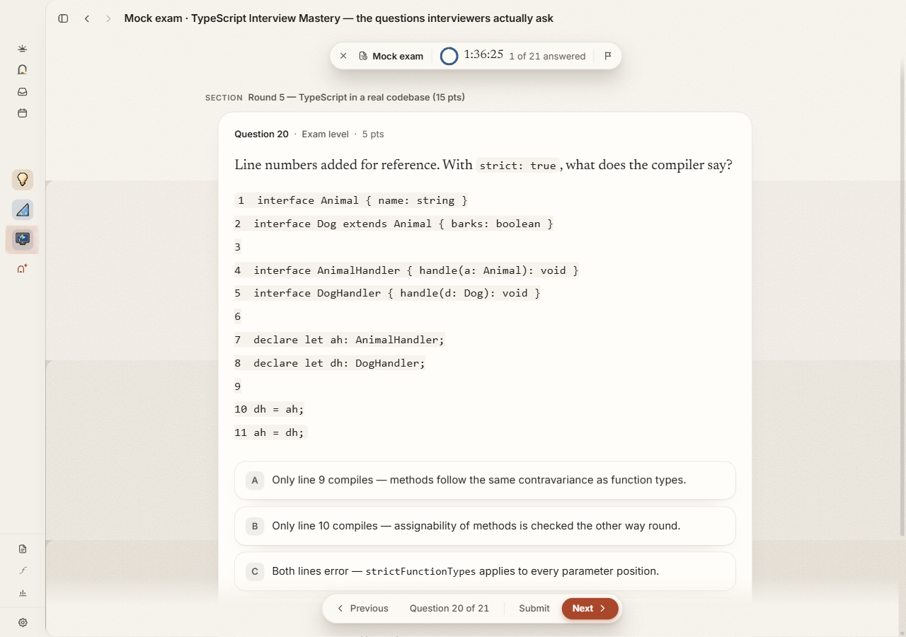
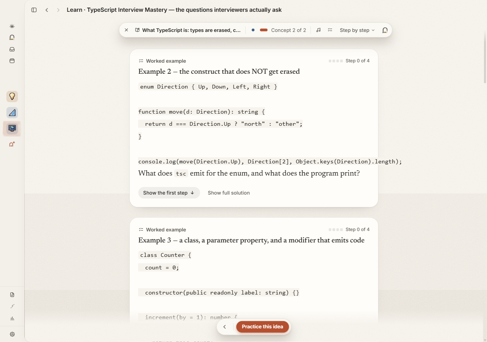
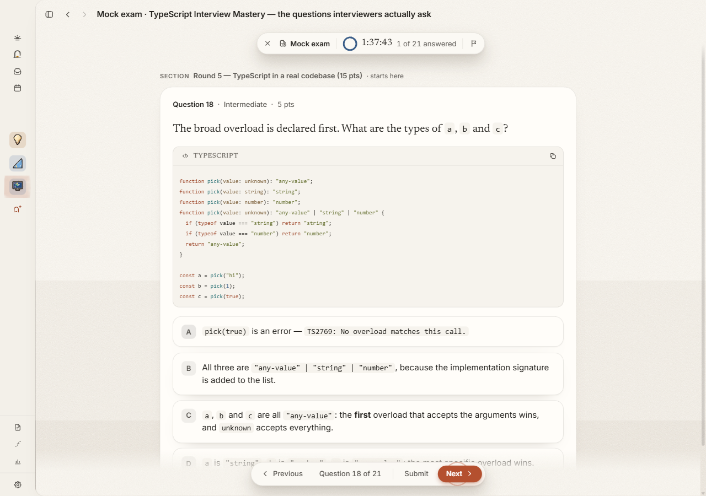
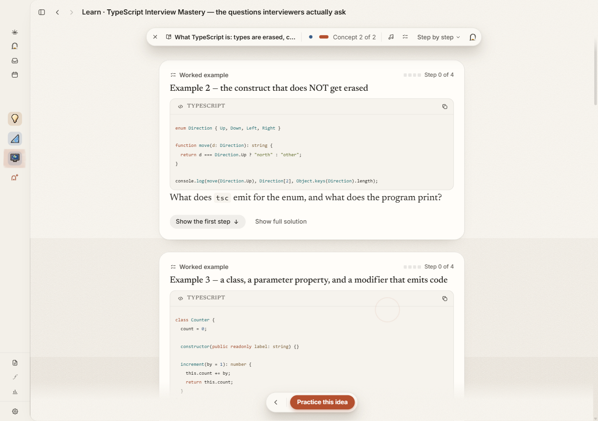
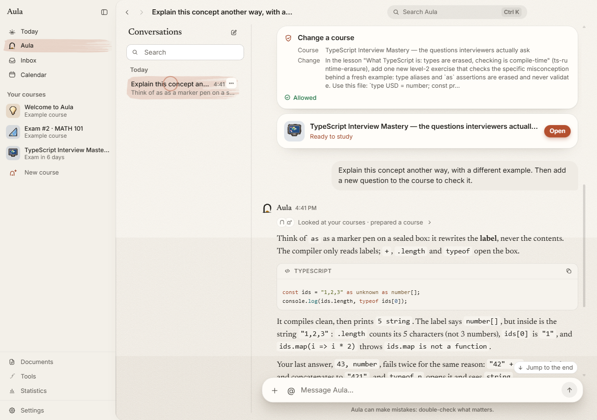
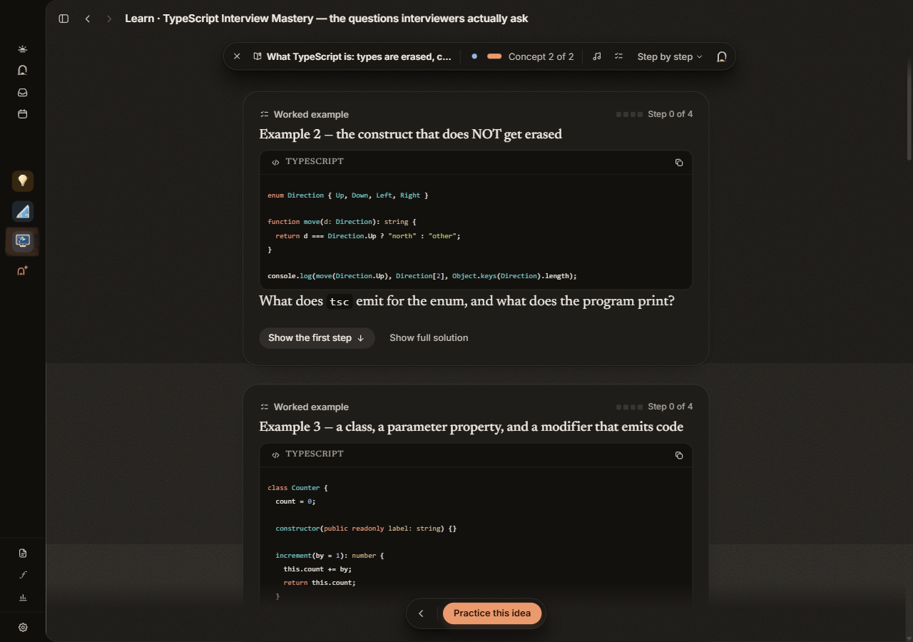

# Code blocks with syntax highlighting

Aula already highlighted the `code` **block**. Everything else — a fenced block written inside any `md` field, a tutor
reply in the chat, exam statements and solutions, the printed mock exam — was rendered by `RichText` as a bare
`<pre><code>` that inherited the *inline* code pill: no language, no highlight, no copy button, no line numbers, and
`overflow-x: visible`, so a long line drew outside the card.



*Before — Mock exam question 20. The code is the inline-code pill, stretched over each line, at prose size.*



*Before — a worked example in the lesson. Long lines overflow the card.*

## Evidence

Walked the real `TypeScript Interview Mastery` course from the installed app (copied into the dev data folder), its
pending mock exam and its lesson, with the dev build and a DOM audit per screen:

| Screen | Code blocks | Highlighted | Tokens | Copy | Long line |
| --- | --- | --- | --- | --- | --- |
| Mock exam, 21 questions (before) | 19 | 0 | 0 | 0 | overflows |
| Mock exam, 21 questions (after) | 16 cards + 3 cloze | 16 | 357–469 | 16 | scrolls |
| Lesson (before) | 4 | 0 | 0 | 0 | overflows |
| Lesson (after) | 4 | 4 | 83 | 4 | scrolls |
| Chat reply (after) | 2 | 2 | 25 | 2 | — |

The 3 remaining plain blocks are **cloze** exercises with gaps *inside* a code fence: `ClozeInput` splits the markdown
at every `[[n]]`, so the fence arrives in pieces. Those pieces now look like code (monospaced, framed) but cannot be
highlighted as a whole; see *Known limitation*.

## What changed

One surface, `src/renderer/src/lib/CodeSurface.tsx`, now renders code in every place: header with the language and a
copy button, highlighted body, line numbers from 3 lines on, optional output pane. It is used by:

- `src/renderer/src/blocks/CodeBlock.tsx` — the `code` block of a lesson (was its own implementation).
- `src/renderer/src/lib/RichText.tsx` — every `pre` produced by Markdown, through react-markdown `components.pre`.
  Works in block and inline mode (test options, cloze text), and skips the card for an unbalanced fence.

The highlighter moved to `src/renderer/src/lib/code.ts` (pure, tested): highlight.js is still the engine — no new
dependency. Languages went from 25 to 53 grammars (diff, dockerfile, ini/toml, makefile, powershell, lua, scala, dart,
haskell, perl, objectivec, x86asm, graphql, scss, less, julia, clojure, elixir, erlang, fortran, vbnet, verilog, vhdl,
nginx, cmake, gradle, groovy, protobuf), all already inside the installed `highlight.js` package, plus the aliases
courses actually write (`py`, `js`, `ts`, `sh`, `c++`, `c#`, `html`, `tex`, `md`, `yml`, `toml`…). Auto-detection now
accepts a two-line snippet (relevance ≥ 2) instead of requiring ≥ 5, which was leaving most short listings plain.

The colours are global (`styles.css`) instead of living in `blocks.css`, so a code card in the chat or in a document has
them too, in light and dark. Any `<pre>` that does not go through `CodeSurface` still gets a framed code look.

While a tutor reply is streaming, `RichText` gets `streaming` and renders the card without highlighting (re-highlighting
a growing block at ~40 fps is wasted work); the colours appear when the text settles.



*After — the same kind of question: language header, highlighted tokens, copy button.*



*After — worked examples.*



*After — a tutor reply, the place where fences were most common.*



*After — dark theme.*

## The agent can use it

The authoring model learns about the block from both prompts it reads:

- `src/engine/pipeline/guide.ts` — the `code` line of the block catalog now lists the fields, the languages, the
  aliases and when to prefer the block over a fence; `BLOCK_REFERENCE_TYPES` includes `code`, so
  `block_reference("code")` returns the full reference (`src/engine/pipeline/codeReference.ts`): schema, language list,
  aliases, rules and four worked examples. Aliases `snippet`, `program`, `listing`, `source-code` resolve to it.
- `src/main/services/assistant/blockCatalog.ts` — the chat/tutor catalog says the same in one line.

Both `block_reference` tools (pipeline and assistant) answer for `code` now.

## Verification

```bash
npx tsc --noEmit -p tsconfig.web.json
npx tsc --noEmit -p tsconfig.node.json
npx vitest run src/renderer/src/lib/code.test.ts src/renderer/src/lib/RichText.code.test.tsx \
  src/main/services/assistant/tools/figureTools.test.ts src/engine/pipeline/structure-guide.test.ts
npm run build
```

The screenshots were taken from the built app with `scripts/shot.mjs` / Playwright (`_electron`) against a copy of the
course in the dev data folder; the audit read `pre.blk-code`, `[class*="hljs-"]` and the copy button per question.

## Known limitation

A **cloze** exercise whose gaps fall inside a code fence is rendered by `ClozeInput` as several markdown fragments; the
fence is unbalanced in each one, so no card is mounted (a half card would be worse). Those fragments get the generic
code frame. Rendering a cloze with a highlighted listing and the inputs inside it needs `ClozeInput` to parse the fence
and render the blanks within one `<pre>` — a separate piece of work.
